# 🚀 Integración de SonarQube con Spring Boot

- 📚 **Fuente base**: Tutorial del canal [Un Programador Nace](https://www.youtube.com/watch?v=H7XvwUMaCno)
- 💻 **Proyecto base**: `spring-rest-api`, parte del conjunto de proyectos `java-spring-test-suite`.

---

Antes de integrar `SonarQube` con nuestro proyecto `Spring Boot`, exploraremos una herramienta muy útil a nivel de
IDE que complementa el análisis estático de código: `SonarQube for IDE` (antes `SonarLint`).

## 🧩 Plugin SonarQube for IDE (Antes SonarLint)

`SonarQube for IDE`, anteriormente conocido como `SonarLint`, es una extensión oficial gratuita de `Sonar` que realiza
`análisis estático de código en tiempo real` directamente desde el IDE.

Su propósito principal es `mejorar la calidad y seguridad del código desde el momento en que se escribe`,
antes incluso de que llegue al repositorio o sea analizado por el servidor de `SonarQube`.

### ⚙️ Características clave

- Analiza el código fuente a medida que lo escribes.
- Detecta code smells, bugs, vulnerabilidades y malas prácticas.
- Ofrece quick fixes y sugerencias con contexto técnico detallado.
- Explica el "por qué" de cada problema, actuando como un tutor técnico.
- Puede conectarse a un servidor `SonarQube local` o en la nube (`SonarCloud`) para sincronizar reglas y políticas de
  calidad.
- Compatible con múltiples lenguajes: Java, Kotlin, C#, JavaScript, TypeScript, Python, Go, PHP, HTML, CSS, entre otros.

> 💡 `En entornos corporativos`, esta herramienta permite mantener consistencia en las reglas de calidad, facilitar
> revisiones de código y detectar vulnerabilidades antes de subir cambios al repositorio.

### 🛠️ Instalación del plugin SonarQube for IDE

Instalemos el plugin desde `IntelliJ IDEA`:

1. Abre `File → Settings → Plugins`.
2. Ve a la pestaña `Marketplace`.
3. Busca `SonarQube for IDE`.
4. Haz clic en `Install`.
5. Reinicia el IDE para activar el plugin.

En la siguiente imagen, se muestra el plugin correctamente instalado:

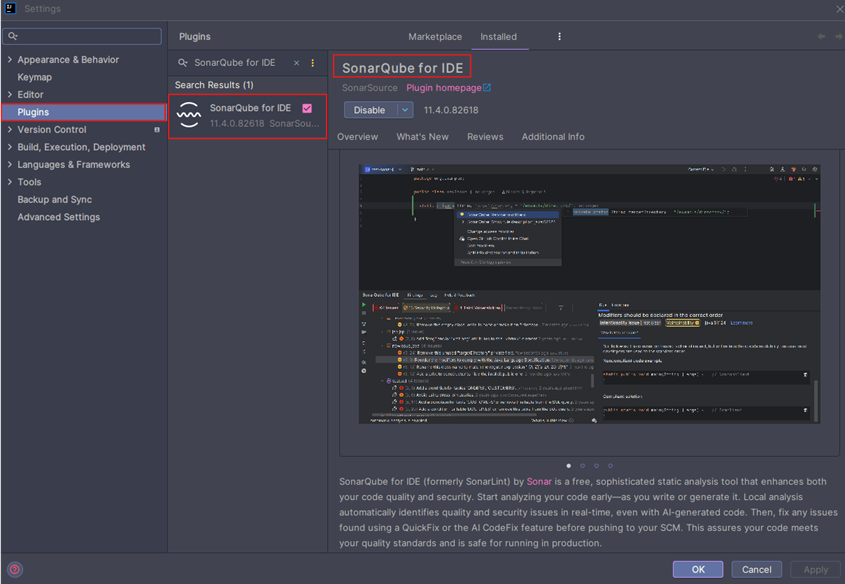

## 🎯 Funcionamiento de SonarQube for IDE

Una vez instalado, el plugin se `activa automáticamente`. El análisis puede ejecutarse de dos formas:

- 🕒 `Automático`: cada vez que escribes o modificas código.
- ⚡ `Manual`: usando combinaciones de teclas, el menú contextual o la consola interna de `SonarQube for IDE`.

Veamos un ejemplo práctico.

Supongamos que abrimos el controlador `BankController` de nuestro proyecto y modificamos el método de un endpoint
para usar un tipo comodín `(?)` en la respuesta. Al guardar, el plugin analiza el código y muestra en la esquina
superior derecha un ícono rojo con un número, indicando la cantidad de incidencias detectadas.

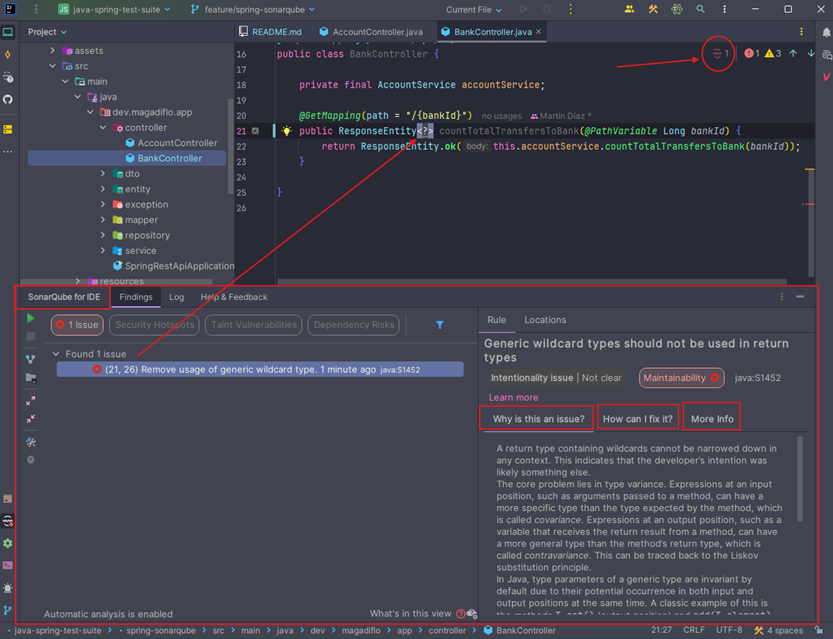

Si hacemos clic en el ícono rojo, se abrirá una consola en la parte inferior del IDE mostrando los detalles de los
hallazgos. En este caso, `Sonar` detecta una violación de regla en la `línea 21`:

> ⚠️ “No se deben usar tipos comodín genéricos en los tipos de retorno.”

Esto significa que usar `ResponseEntity<?>` puede reducir la legibilidad y la claridad del contrato del endpoint.
La práctica recomendada sería definir un tipo concreto o una clase DTO específica.

### 💡 Nota práctica

En entornos profesionales, las empresas suelen combinar el uso de `SonarQube for IDE` con una instancia central de
`SonarQube Server`. Esto permite:

- Aplicar reglas de calidad homogéneas en todo el equipo.
- Evitar “sorpresas” en el análisis del pipeline CI/CD.
- Mejorar la consistencia del código antes de los code reviews.

Por tanto, `SonarQube for IDE actúa como la primera línea de defensa` en la calidad del código, detectando errores
antes de que lleguen al servidor o repositorio.

### 🎯 Próximo paso

Ya entendemos el propósito del plugin y su rol en el desarrollo diario. A continuación, procederemos con la integración
de `SonarQube` + `Spring Boot`, que es el objetivo central de este tutorial.

---

# 🧠 ¿Qué es SonarQube?

`SonarQube` es una plataforma `open-source` para el `análisis estático de código` desarrollada por `SonarSource` que
ayuda a los equipos de desarrollo a `mejorar la calidad, seguridad y mantenibilidad del software`.

Su función principal es `analizar el código fuente` de un proyecto y generar un `informe de calidad` con métricas,
advertencias y recomendaciones sobre aspectos como:

- 🪲 `Bugs (errores potenciales)`: fragmentos de código que podrían causar fallos en tiempo de ejecución.
- ⚔️ `Vulnerabilidades`: posibles brechas de seguridad en el código.
- 🌫️ `Code Smells`: malas prácticas que afectan la legibilidad o mantenibilidad.
- 🧱 `Duplicaciones`: bloques de código repetidos que dificultan el mantenimiento.
- 🧪 `Coverage`: porcentaje de cobertura de pruebas unitarias e integración.
- 🧩 `Debt Ratio (deuda técnica)`: tiempo estimado para corregir las malas prácticas detectadas.

### 💡 ¿Por qué las empresas utilizan SonarQube?

En entornos empresariales, `SonarQube` se convierte en un `componente clave del ciclo de integración continua (CI/CD)`.
Permite mantener estándares de calidad de código homogéneos entre los equipos y garantizar que las nuevas versiones
del software no introduzcan errores ni vulnerabilidades.

Usos típicos en empresas:

1. 🔍 Se ejecuta automáticamente durante el `build` del proyecto (por ejemplo, en `Jenkins`, `GitLab CI` o
   `GitHub Actions`).
2. 📦 El servidor `SonarQube` recibe los resultados del análisis.
3. 📈 Se generan `dashboards` con métricas de calidad y umbrales `(Quality Gates)`.
4. 🚫 Si el código no cumple los estándares definidos, el pipeline puede fallar antes del despliegue.
5. 💬 En otras palabras, `SonarQube` actúa como un guardia de calidad continua, previniendo que código inseguro o mal
   estructurado llegue a producción.

### ⚙️ Arquitectura básica de SonarQube

Un entorno típico de SonarQube consta de tres componentes principales:

| Componente                              | Descripción                                                                                                                              |
|-----------------------------------------|------------------------------------------------------------------------------------------------------------------------------------------|
| 🧩 **SonarQube Server**                 | Servidor principal que recibe los resultados del análisis, los almacena en una base de datos y muestra los reportes en una interfaz web. |
| 🧠 **SonarScanner**                     | Cliente o agente que analiza el código y envía los resultados al servidor. Se ejecuta localmente o dentro de un pipeline CI/CD.          |
| 🧑‍💻 **SonarQube for IDE (SonarLint)** | Plugin del IDE que permite analizar el código en tiempo real mientras se escribe.                                                        |

### 🎯 Beneficios clave

- ✅ Mejora la calidad del código desde etapas tempranas.
- ✅ Reduce la deuda técnica acumulada en proyectos grandes.
- ✅ Promueve estándares de desarrollo uniformes en toda la organización.
- ✅ Facilita auditorías de seguridad y cumplimiento (por ejemplo, OWASP, CWE, etc.).
- ✅ Se integra fácilmente con herramientas empresariales como Jenkins, GitLab CI/CD, GitHub Actions o Azure DevOps.

### 💡 Conclusión

`SonarQube` no solo es una herramienta de análisis, sino un `ecosistema completo de calidad de software`.
Ayuda a los equipos a mantener un código `limpio, seguro y sostenible`, alineando la práctica técnica diaria con las
políticas de calidad de la empresa.

## [🐳 Configurar Docker Compose para SonarQube](https://docs.sonarsource.com/sonarqube/latest/setup-and-upgrade/install-the-server/installing-sonarqube-from-docker/)

> 📌 Parte de esta configuración se basa en la documentación oficial de `SonarQube`, en el apartado
> [Installing SonarQube Server Developer or Enterprise Edition from the Docker image](https://docs.sonarsource.com/sonarqube/latest/setup-and-upgrade/install-the-server/installing-sonarqube-from-docker/),
> con ajustes adicionales para adaptarla a un entorno de desarrollo profesional.

Antes de integrar `SonarQube` con `Spring Boot`, debemos levantar su entorno de ejecución. Para ello, utilizaremos
`Docker Compose`, que nos permitirá orquestar fácilmente tanto el servicio de `SonarQube` como su base de datos
`PostgreSQL`.

### 📁 Estructura del archivo

Crearemos un archivo llamado `compose.yml` dentro del directorio `spring-sonarqube/docker`.
Este archivo definirá los servicios y volúmenes necesarios para que `SonarQube` funcione correctamente.

Este archivo define dos servicios:

- `s-sonarqube`: servidor `SonarQube`.
- `s-postgres-sonar`: base de datos `PostgreSQL`.

````yml
services:
  s-sonarqube:
    image: sonarqube:25.10.0.114319-community
    container_name: c-sonarqube
    restart: unless-stopped
    ports:
      - '9000:9000'
    environment:
      SONAR_JDBC_URL: jdbc:postgresql://s-postgres-sonar:5432/db_sonar_dev
      SONAR_JDBC_USERNAME: sonar_dev_user
      SONAR_JDBC_PASSWORD: sonar_dev_password
    volumes:
      - sonarqube_data:/opt/sonarqube/data
      - sonarqube_extensions:/opt/sonarqube/extensions
      - sonarqube_logs:/opt/sonarqube/logs
    networks:
      - sonarqube-net
    depends_on:
      - s-postgres-sonar

  s-postgres-sonar:
    image: postgres:17-alpine
    container_name: c-postgres-sonar
    restart: unless-stopped
    ports:
      - '5433:5432'
    environment:
      POSTGRES_DB: db_sonar_dev
      POSTGRES_USER: sonar_dev_user
      POSTGRES_PASSWORD: sonar_dev_password
    volumes:
      - postgres-sonar-data:/var/lib/postgresql/data
    networks:
      - sonarqube-net

volumes:
  sonarqube_data:
    name: sonarqube_data
  sonarqube_extensions:
    name: sonarqube_extensions
  sonarqube_logs:
    name: sonarqube_logs
  postgres-sonar-data:
    name: postgres-sonar-data

networks:
  sonarqube-net:
    name: sonarqube-net
````

### ⚙️ Explicación técnica de la configuración

| Componente                                  | Descripción                                                                                                                       |
|---------------------------------------------|-----------------------------------------------------------------------------------------------------------------------------------|
| `image: sonarqube:25.10.0.114319-community` | Usa la versión estable más reciente de SonarQube Community Edition.                                                               |
| `ports: 9000:9000`                          | Expone `SonarQube` en el puerto 9000. Accederás en `http://localhost:9000` (usuario y contraseña por defecto: `admin` / `admin`). |
| `SONAR_JDBC_URL`                            | URL JDBC para conectar SonarQube con PostgreSQL.                                                                                  |
| `SONAR_JDBC_USERNAME`                       | Usuario de la base de datos.                                                                                                      |
| `SONAR_JDBC_PASSWORD`                       | Contraseña de la base de datos.                                                                                                   |
| `depends_on`                                | Garantiza que la base de datos se levante antes que SonarQube.                                                                    |
| `restart: unless-stopped`                   | Reinicia el contenedor si falla, excepto si fue detenido manualmente.                                                             |

#### 🗄️ Configuración de la base de datos

> `SonarQube` no debe usarse con `H2` en producción. En entornos empresariales siempre se recomienda `PostgreSQL`,
> ya que es el único motor oficialmente soportado para producción.

### 📦 Volúmenes persistentes

Estos volúmenes permiten mantener datos entre reinicios o actualizaciones:

| Volumen                | Propósito                                                       |
|------------------------|-----------------------------------------------------------------|
| `sonarqube_data`       | Índices de Elasticsearch, configuraciones y datos de análisis.  |
| `sonarqube_logs`       | Logs de acceso, procesos web, CE y Elasticsearch.               |
| `sonarqube_extensions` | Plugins instalados y drivers JDBC (como Oracle si se requiere). |
| `postgres-sonar-data`  | atos persistentes de la base de datos PostgreSQL.               |

> 🧠 `Nota técnica`: En entornos corporativos, estos volúmenes son clave para mantener la integridad del sistema
> ante actualizaciones o migraciones.

### ✅ Buenas prácticas corporativas

- 🔒 `PostgreSQL como base de datos`: Es la opción recomendada por `SonarQube` y ampliamente usada en empresas por su
  estabilidad y soporte oficial.
- 📁 `Separación de volúmenes`: Facilita backups, restauraciones y actualizaciones sin pérdida de datos.
- 🧩 `Uso de Alpine en PostgreSQL`: Reduce el tamaño de la imagen y mejora tiempos de despliegue.

## 🚀 Levantando el entorno SonarQube con Docker Compose

Una vez definido el archivo `compose.yml`, podemos levantar los contenedores de `SonarQube` y `PostgreSQL` ejecutando
el siguiente comando desde la raíz del proyecto o asegurándonos de apuntar correctamente a la ruta donde se encuentra
el `compose.yml`:

````bash
D:\programming\spring\01.udemy\02.andres_guzman\03.junit_y_mockito_2023\java-spring-test-suite (feature/spring-sonarqube)
$ docker compose -f .\spring-sonarqube\docker\compose.yml up -d                                                          
...
 ✔ Network sonarqube-net        Created                                                                                  
 ✔ Volume sonarqube_extensions  Created                                                                                  
 ✔ Volume sonarqube_logs        Created                                                                                  
 ✔ Volume postgres-sonar-data   Created                                                                                  
 ✔ Volume sonarqube_data        Created                                                                                  
 ✔ Container c-postgres-sonar   Started                                                                                  
 ✔ Container c-sonarqube        Started                                                                                   
````

Este comando:

- Descarga las imágenes necesarias (sonarqube y postgres).
- Crea la red y los volúmenes definidos.
- Inicia ambos contenedores en segundo plano (-d = detached mode)

### 🧠 Verificando contenedores activos

Podemos confirmar que ambos servicios se están ejecutando con el siguiente comando:

````bash
$ docker container ls -a
CONTAINER ID   IMAGE                                COMMAND                  CREATED         STATUS             PORTS                                         NAMES
5ad90230cf61   sonarqube:25.10.0.114319-community   "/opt/sonarqube/dock…"   3 minutes ago   Up 3 minutes       0.0.0.0:9000->9000/tcp, [::]:9000->9000/tcp   c-sonarqube
c02d7529f0cb   postgres:17-alpine                   "docker-entrypoint.s…"   3 minutes ago   Up 3 minutes       0.0.0.0:5433->5432/tcp, [::]:5433->5432/tcp   c-postgres-sonar
````

### 🧩 Verificando la base de datos y sus tablas

Para confirmar que la base de datos fue creada correctamente dentro del contenedor de `PostgreSQL`, podemos acceder
a él directamente:

````bash
D:\programming\spring\01.udemy\02.andres_guzman\03.junit_y_mockito_2023\java-spring-test-suite (feature/spring-sonarqube)
$ docker container exec -it c-postgres-sonar /bin/sh
/ # psql -U sonar_dev_user -d db_sonar_dev
psql (17.5)
Type "help" for help.

db_sonar_dev=# \l
                                                               List of databases
     Name     |     Owner      | Encoding | Locale Provider |  Collate   |   Ctype    | Locale | ICU Rules |         Access privileges
--------------+----------------+----------+-----------------+------------+------------+--------+-----------+-----------------------------------
 db_sonar_dev | sonar_dev_user | UTF8     | libc            | en_US.utf8 | en_US.utf8 |        |           |
 postgres     | sonar_dev_user | UTF8     | libc            | en_US.utf8 | en_US.utf8 |        |           |
 template0    | sonar_dev_user | UTF8     | libc            | en_US.utf8 | en_US.utf8 |        |           | =c/sonar_dev_user                +
              |                |          |                 |            |            |        |           | sonar_dev_user=CTc/sonar_dev_user
 template1    | sonar_dev_user | UTF8     | libc            | en_US.utf8 | en_US.utf8 |        |           | =c/sonar_dev_user                +
              |                |          |                 |            |            |        |           | sonar_dev_user=CTc/sonar_dev_user
(4 rows)

db_sonar_dev=# \dt
                      List of relations
 Schema |           Name            | Type  |     Owner
--------+---------------------------+-------+----------------
 public | active_rule_parameters    | table | sonar_dev_user
 public | active_rules              | table | sonar_dev_user
 public | alm_pats                  | table | sonar_dev_user
 ...
 public | user_dismissed_messages   | table | sonar_dev_user
 public | user_roles                | table | sonar_dev_user
 public | user_tokens               | table | sonar_dev_user
 public | users                     | table | sonar_dev_user
 public | webhook_deliveries        | table | sonar_dev_user
 public | webhooks                  | table | sonar_dev_user
(109 rows)

db_sonar_dev=# 
````

En este punto, `SonarQube` ya ha inicializado su esquema interno en `PostgreSQL`, creando más de 100 tablas que
almacenan reglas, análisis, configuraciones de proyectos, usuarios, tokens, entre otros. Esto confirma que la conexión
entre `SonarQube` y `PostgreSQL` está funcionando correctamente.

### 🖥️ Visualización desde DBeaver (opcional)

También podemos verificar la estructura de la base de datos conectándonos desde `DBeaver`
(o cualquier cliente SQL) usando las credenciales definidas en el `compose.yml`:

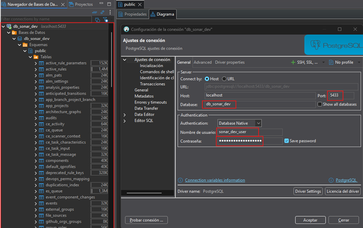

💡 Consejo profesional:
> En entornos empresariales se acostumbra conectar herramientas de administración como `pgAdmin` o `DBeaver` a
> contenedores `PostgreSQL` para validaciones rápidas, debugging y auditoría de integraciones.

## 🌐 Accediendo a SonarQube

Una vez que los contenedores de `SonarQube` y `PostgreSQL` estén en ejecución, podemos acceder a la interfaz web de
`SonarQube` desde nuestro navegador.

🔗 URL de acceso: http://localhost:9000

> 💡 `Recordatorio`: Este puerto (`9000`) fue configurado previamente en el archivo `compose.yml`, dentro del mapeo
> `9000:9000`.

### 🔑 Inicio de sesión inicial

Al ingresar por primera vez, `SonarQube` mostrará una pantalla de autenticación solicitando usuario y contraseña.
Las credenciales por defecto son:

| Campo      | Valor por defecto |
|------------|-------------------|
| Usuario    | `admin`           |
| Contraseña | `admin`           |

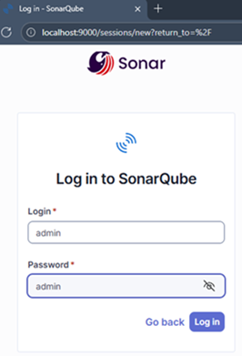

### 🔐 Cambio obligatorio de contraseña

Por razones de seguridad, `SonarQube` nos solicitará actualizar la contraseña del usuario `admin` en el primer acceso.
En este ejemplo, definimos una nueva contraseña segura:

| Campo      | Valor por defecto    |
|------------|----------------------|
| Usuario    | `admin`              |
| Contraseña | `$onarQubeAdmin2025` |

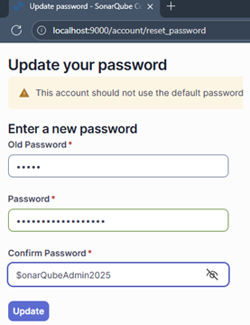

⚙️ Explicación técnica:

> `SonarQube` almacena las credenciales de usuarios en la base de datos `PostgreSQL` y encripta las contraseñas usando
> `BCrypt`. Por política interna, no permite continuar usando la contraseña por defecto en instancias nuevas para
> evitar accesos no autorizados.

### 🏠 Pantalla principal de SonarQube

Una vez actualizada la contraseña, seremos redirigidos al `Dashboard principal`, donde podremos:

- Crear o importar proyectos.
- Ver resultados de análisis de calidad.
- Configurar reglas de análisis, plugins y políticas de seguridad.

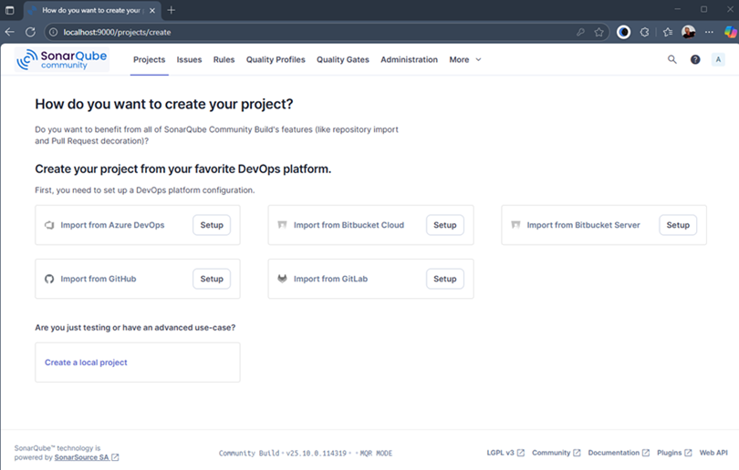

## 🔐 Generando un Token de Seguridad para el acceso desde Spring Boot a SonarQube

Para que nuestro proyecto `Spring Boot` pueda autenticarse ante el servidor de `SonarQube`, debemos generar un
`token de seguridad`. Este token sustituye el uso de `usuario/contraseña` y es el mecanismo estándar de autenticación
cuando integramos `SonarQube` con herramientas externas (por ejemplo, `Maven`, `Jenkins` o `GitHub Actions`).

### 👤 Accediendo a la configuración de usuario

Desde la interfaz principal de `SonarQube`, hacemos clic en nuestro perfil (parte superior derecha) y seleccionamos:
`My Account → Security`.

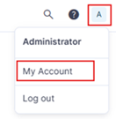

### ⚙️ Creación del token

En la pestaña `Security`, completamos los siguientes campos:

| Campo          | Valor sugerido          | Descripción                                                                      |
|----------------|-------------------------|----------------------------------------------------------------------------------|
| **Name**       | `local-analysis`        | Nombre identificador del token (puede ser cualquier alias descriptivo).          |
| **Type**       | `Global Analysis Token` | Permite ejecutar análisis sobre cualquier proyecto asociado al usuario.          |
| **Expires in** | `No expiration`         | En este ejemplo no tendrá fecha de expiración, ya que se usará en entorno local. |

Luego hacemos clic en el botón `Generate`.

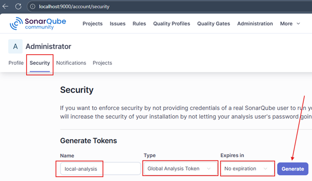

### 📋 Copiando el token generado

`SonarQube` mostrará un mensaje como el siguiente:

> ✅ “Se ha creado un nuevo token llamado `local-analysis`. ¡Asegúrate de copiarlo ahora, no podrás volver a verlo!”

Esto significa que el token solo se muestra una vez al momento de su creación. Cópialo y guárdalo de forma segura,
ya que no podrá recuperarse después.

````
Token: sqa_a0bc5503b5942ddf4739558c59bbb35b66869a66 
````

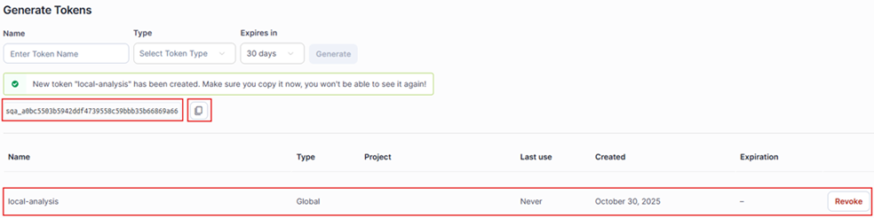

⚠️ Importante:
> Nunca compartas este token en repositorios públicos, documentación compartida o pipelines sin cifrado.
> Cualquier persona que posea el token puede ejecutar análisis o modificar configuraciones en tu servidor `SonarQube`.

## 🧩 Configurando el Plugin JaCoCo para medir la cobertura de código

Antes de integrar `SonarQube` con nuestra aplicación `Spring Boot`, es fundamental configurar correctamente el
`plugin de JaCoCo`, ya que este será el encargado de `generar los reportes de cobertura de pruebas unitarias` que
`SonarQube` utilizará para sus `análisis de calidad`.

> 💡 `JaCoCo (Java Code Coverage)` es una herramienta open source que mide qué porcentaje del código ha sido ejecutado
> durante las pruebas. Nos ayuda a identificar clases o métodos no cubiertos por tests y es el estándar más usado junto
> con `SonarQube`.

### ⚙️ Configuración del plugin de JaCoco en el `pom.xml`

Agregamos la siguiente configuración del `plugin de JaCoCo` dentro del archivo `pom.xml` de nuestro proyecto:

````xml

<project>
    <properties>
        <!-- Versión del plugin JaCoCo -->
        <jacoco.version>0.8.12</jacoco.version>
    </properties>
    <build>
        <plugins>
            <!--JaCoCo Maven Plugin-->
            <plugin>
                <groupId>org.jacoco</groupId>
                <artifactId>jacoco-maven-plugin</artifactId>
                <version>${jacoco.version}</version>
                <configuration>
                    <excludes>
                        <!-- Clases de arranque -->
                        <exclude>**/SpringSonarQubeApplication.class</exclude>

                        <!-- DTOs y entidades JPA -->
                        <exclude>**/dto/**</exclude>
                        <exclude>**/entity/**</exclude>

                        <!-- Mappers y configuraciones -->
                        <exclude>**/mapper/**</exclude>
                        <exclude>**/config/**</exclude>

                        <!-- Excepciones personalizadas -->
                        <exclude>**/exception/*Exception.class</exclude>

                        <!-- Clases generadas automáticamente -->
                        <exclude>**/*MapperImpl.class</exclude>
                    </excludes>
                </configuration>
                <executions>
                    <!--Preparar agente de JaCoCo antes de ejecutar tests-->
                    <execution>
                        <id>prepare-agent</id>
                        <goals>
                            <goal>prepare-agent</goal>
                        </goals>
                    </execution>

                    <!--Generar reporte después de ejecutar tests-->
                    <execution>
                        <id>report</id>
                        <phase>test</phase>
                        <goals>
                            <goal>report</goal>
                        </goals>
                    </execution>

                    <!-- Define un umbral mínimo de cobertura aceptable -->
                    <execution>
                        <id>check</id>
                        <goals>
                            <goal>check</goal>
                        </goals>
                        <configuration>
                            <rules>
                                <rule>
                                    <element>PACKAGE</element>
                                    <limits>
                                        <limit>
                                            <counter>LINE</counter>
                                            <value>COVEREDRATIO</value>
                                            <minimum>0.80</minimum> <!-- 80% cobertura mínima -->
                                        </limit>
                                    </limits>
                                </rule>
                            </rules>
                        </configuration>
                    </execution>
                </executions>
            </plugin>
            <!--/JaCoCo Maven Plugin-->
        </plugins>
    </build>

</project>
````

### 📂 Ubicación del reporte

Por defecto, `JaCoCo` genera los resultados en:

````
target/site/jacoco/index.html     ← Reporte HTML
target/site/jacoco/jacoco.xml     ← Reporte XML (versiones recientes)
target/jacoco.exec                ← Reporte binario (para SonarQube)
````

> 🔎 `Tip`: Podemos abrir el archivo `index.html` en el navegador para visualizar de forma gráfica qué clases y métodos
> fueron cubiertos por los tests.

## ✅ Ejecutando pruebas unitarias y validando cobertura con JaCoCo

Una vez configurado el plugin de `JaCoCo`, procedemos a ejecutar nuestras pruebas unitarias para generar los
reportes de cobertura.

### ▶️ Ejecución de pruebas unitarias

Ejecutamos el siguiente comando:

````bash
D:\programming\spring\01.udemy\02.andres_guzman\03.junit_y_mockito_2023\java-spring-test-suite\spring-sonarqube (feature/spring-sonarqube)
$ mvn clean test
[INFO] Scanning for projects...
...
[INFO]
[INFO] Tests run: 25, Failures: 0, Errors: 0, Skipped: 0
[INFO]
[INFO]
[INFO] --- jacoco:0.8.12:report (report) @ spring-sonarqube ---
[INFO] Loading execution data file D:\programming\spring\01.udemy\02.andres_guzman\03.junit_y_mockito_2023\java-spring-test-suite\spring-sonarqube\target\jacoco.exec
[INFO] Analyzed bundle 'spring-sonarqube' with 4 classes
[INFO] ------------------------------------------------------------------------
[INFO] BUILD SUCCESS
[INFO] ------------------------------------------------------------------------
[INFO] Total time:  18.799 s
[INFO] Finished at: 2025-10-31T17:07:00-05:00
[INFO] ------------------------------------------------------------------------
````

El resultado muestra que todas las pruebas se ejecutaron correctamente y que `JaCoCo` generó los archivos de reporte
correspondientes (`.exec`, `.xml` y `.html`).

### 📊 Verificando cobertura mínima con Maven

Para validar el porcentaje de cobertura definido en el plugin (`<minimum>0.80</minimum>`), ejecutamos:

````bash
D:\programming\spring\01.udemy\02.andres_guzman\03.junit_y_mockito_2023\java-spring-test-suite\spring-sonarqube (feature/spring-sonarqube)
$ mvn clean verify
[INFO] Scanning for projects...
[INFO]
...
[INFO]
[INFO] --- jacoco:0.8.12:check (check) @ spring-sonarqube ---
[INFO] Loading execution data file D:\programming\spring\01.udemy\02.andres_guzman\03.junit_y_mockito_2023\java-spring-test-suite\spring-sonarqube\target\jacoco.exec
[INFO] Analyzed bundle 'spring-sonarqube' with 4 classes
[WARNING] Rule violated for package dev.magadiflo.app.exception: lines covered ratio is 0.28, but expected minimum is 0.80
[WARNING] Rule violated for package dev.magadiflo.app.controller: lines covered ratio is 0.55, but expected minimum is 0.80
[INFO] ------------------------------------------------------------------------
[INFO] BUILD FAILURE
[INFO] ------------------------------------------------------------------------
[INFO] Total time:  18.779 s
[INFO] Finished at: 2025-10-31T17:08:05-05:00
[INFO] ------------------------------------------------------------------------
[ERROR] Failed to execute goal org.jacoco:jacoco-maven-plugin:0.8.12:check (check) on project spring-sonarqube: Coverage checks have not been met. See log for details. -> [Help 1]
[ERROR]
[ERROR] To see the full stack trace of the errors, re-run Maven with the -e switch.
[ERROR] Re-run Maven using the -X switch to enable full debug logging.
[ERROR]
[ERROR] For more information about the errors and possible solutions, please read the following articles:
[ERROR] [Help 1] http://cwiki.apache.org/confluence/display/MAVEN/MojoExecutionException
````

Durante esta fase, `JaCoCo` aplicará las reglas de cobertura configuradas en el bloque `<check>` del `pom.xml`.
En este caso, vemos que dos paquetes no alcanzaron el umbral mínimo del `80%`:

- `dev.magadiflo.app.exception`: `28%`
- `dev.magadiflo.app.controller`: `55%`

## 🧪 Implementando pruebas unitarias para cumplir el umbral de cobertura

Como vimos anteriormente, los paquetes `dev.magadiflo.app.exception` y `dev.magadiflo.app.controller` no alcanzaron el
umbral mínimo de cobertura (`80%`) establecido en la configuración de `JaCoCo`. Para corregir esto, agregaremos pruebas
unitarias adicionales que validen los métodos faltantes.

💡 `Nota`:
> El objetivo de esta sección no es aumentar la cobertura artificialmente, sino garantizar que las clases críticas
> estén efectivamente cubiertas por pruebas significativas.

### 🧩 Añadiendo pruebas en AccountControllerTest

La primera clase con bajo porcentaje fue el `controller`, que gestiona las operaciones principales de cuentas.
A continuación, se muestra la clase de pruebas donde se añadieron los tests faltantes para cubrir las operaciones
`update`, `delete`, `deposit` y `withdraw`.

````java

@Tag("unit")
@WebMvcTest(AccountController.class)
class AccountControllerTest {

    @MockitoBean
    private AccountService accountService;

    @Autowired
    private MockMvc mockMvc;

    @Autowired
    private ObjectMapper objectMapper;

    /*other tests*/

    @Test
    void shouldUpdateAccountSuccessfully() throws Exception {/*code*/}

    @Test
    void shouldDeleteAccountSuccessfully() throws Exception {/*code*/}

    @Test
    void shouldDepositSuccessfully() throws Exception {/*code*/}

    @Test
    void shouldWithdrawSuccessfully() throws Exception {
        // given
        Long accountId = 1L;
        WithdrawalRequest request = new WithdrawalRequest(new BigDecimal("300"));
        AccountResponse response = new AccountResponse(accountId, "Milagros", new BigDecimal("1700"), "BCP");
        Mockito.when(this.accountService.withdraw(accountId, request)).thenReturn(response);

        // when
        ResultActions result = this.mockMvc.perform(post("/api/v1/accounts/{accountId}/withdraw", accountId)
                .contentType(MediaType.APPLICATION_JSON)
                .content(this.objectMapper.writeValueAsString(request)));

        // then
        result.andExpect(status().isOk())
                .andExpect(content().contentType(MediaType.APPLICATION_JSON))
                .andExpect(jsonPath("$.id", Matchers.is(1)))
                .andExpect(jsonPath("$.holder", Matchers.is("Milagros")))
                .andExpect(jsonPath("$.balance", Matchers.is(1700)))
                .andExpect(jsonPath("$.bankName", Matchers.is("BCP")));
        Mockito.verify(this.accountService).withdraw(accountId, request);
        Mockito.verifyNoMoreInteractions(this.accountService);
    }
}
````

### 🧱 Añadiendo pruebas a GlobalExceptionHandlerTest

En el caso del paquete `exception`, se identificó que el manejador global de excepciones (`GlobalExceptionHandler`) no
estaba cubierto. Por ello, se creó una nueva clase de prueba dedicada exclusivamente a este componente.

````java

@Tag("unit")
@ExtendWith(MockitoExtension.class)
class GlobalExceptionHandlerTest {
    @Mock
    private HttpServletRequest request;
    @Mock
    private BindingResult bindingResult;
    @InjectMocks
    private GlobalExceptionHandler handlerUnderTest;

    @Test
    void shouldHandleValidationErrors() {
        // given
        FieldError fieldError = new FieldError("accountCreateRequest", "holder", "no puede estar vacío");
        Mockito.when(this.bindingResult.getFieldErrors()).thenReturn(List.of(fieldError));

        MethodArgumentNotValidException ex = new MethodArgumentNotValidException(null, this.bindingResult);

        // when
        ResponseEntity<ErrorResponse> response = this.handlerUnderTest.handleValidationErrors(ex, this.request);

        // then
        ErrorResponse error = response.getBody();
        assertThat(response.getStatusCode()).isEqualTo(HttpStatus.BAD_REQUEST);
        assertThat(error).isNotNull();
        assertThat(error.error()).isEqualTo("Validation Failed");
        assertThat(error.validationErrors()).containsKey("holder");
    }

    @Test
    void shouldHandleGenericException() {/*code*/}

    @Test
    void shouldHandleDatabaseOperationException() {/*code*/}

    @Test
    void shouldHandleBankNotFoundException() {/*code*/}

    @Test
    void shouldHandleEntityNotFoundException() {/*code*/}

    @Test
    void shouldHandleInvalidTransactionException() {/*code*/}
}
````

## ✅ Ejecutando pruebas unitarias y validando cobertura con JaCoCo luego de agregar nuevos tests

### ▶️ Ejecución de pruebas unitarias

Una vez agregadas las nuevas pruebas unitarias, procedemos a ejecutar el siguiente comando para validar su correcto
funcionamiento:

````bash
D:\programming\spring\01.udemy\02.andres_guzman\03.junit_y_mockito_2023\java-spring-test-suite\spring-sonarqube (feature/spring-sonarqube)
$ mvn clean test
[INFO] Scanning for projects...
...
[INFO]
[INFO] Tests run: 35, Failures: 0, Errors: 0, Skipped: 0
[INFO]
[INFO]
[INFO] --- jacoco:0.8.12:report (report) @ spring-sonarqube ---
[INFO] Loading execution data file D:\programming\spring\01.udemy\02.andres_guzman\03.junit_y_mockito_2023\java-spring-test-suite\spring-sonarqube\target\jacoco.exec
[INFO] Analyzed bundle 'spring-sonarqube' with 4 classes
[INFO] ------------------------------------------------------------------------
[INFO] BUILD SUCCESS
[INFO] ------------------------------------------------------------------------
[INFO] Total time:  18.217 s
[INFO] Finished at: 2025-10-31T18:06:06-05:00
[INFO] ------------------------------------------------------------------------
````

El resultado muestra que todas las pruebas se ejecutaron correctamente y que `JaCoCo` generó los archivos de reporte
correspondientes (`.exec`, `.xml` y `.html`).

### 📊 Verificando cobertura mínima con Maven

Luego de incorporar los nuevos tests, validamos nuevamente el porcentaje de cobertura configurado en el
`plugin JaCoCo` (por ejemplo,`<minimum>0.80</minimum>`), ejecutando el siguiente comando:

````bash
D:\programming\spring\01.udemy\02.andres_guzman\03.junit_y_mockito_2023\java-spring-test-suite\spring-sonarqube (feature/spring-sonarqube)
$ mvn clean verify
[INFO] Scanning for projects...
[INFO]
...
[INFO]
[INFO] --- jacoco:0.8.12:check (check) @ spring-sonarqube ---
[INFO] Loading execution data file D:\programming\spring\01.udemy\02.andres_guzman\03.junit_y_mockito_2023\java-spring-test-suite\spring-sonarqube\target\jacoco.exec
[INFO] Analyzed bundle 'spring-sonarqube' with 4 classes
[INFO] All coverage checks have been met.
[INFO] ------------------------------------------------------------------------
[INFO] BUILD SUCCESS
[INFO] ------------------------------------------------------------------------
[INFO] Total time:  21.019 s
[INFO] Finished at: 2025-10-31T18:10:37-05:00
[INFO] ------------------------------------------------------------------------
````

### ✅ Resultado

> La salida indica que todas las verificaciones de cobertura se cumplieron satisfactoriamente, es decir, cada paquete
> alcanzó o superó el umbral configurado (`80%` en este caso).

### ⚙️ Explicación técnica

El objetivo de este paso es garantizar que el proyecto cumpla con los requisitos de calidad antes de enviarse al
servidor de análisis estático (`SonarQube`).

Si alguna clase o paquete queda por debajo del umbral, `Maven` marcará el build como fallido, previniendo así que el
código avance a etapas posteriores de integración continua (`CI/CD`).

## 💡 Consideraciones sobre los umbrales de cobertura

La verificación de cobertura que realizamos en este punto pertenece únicamente a `JaCoCo`, el cual valida el
`porcentaje de cobertura definido localmente` dentro del `pom.xml` antes de que el código sea analizado por `SonarQube`.

Sin embargo, `SonarQube también permite establecer su propio umbral mínimo de cobertura` como parte de sus
`Quality Gates`. Esto significa que, además del control técnico local de `JaCoCo`, el servidor `SonarQube` puede
aplicar un control adicional más estricto sobre la calidad global del proyecto.

### 🎯 Estrategia recomendada en entornos reales

Se recomienda utilizar ambos controles de forma complementaria, con umbrales diferenciados:

| Herramienta | Umbral sugerido | Propósito                                                           |
|-------------|:---------------:|---------------------------------------------------------------------|
| `JaCoCo`    |      `80%`      | Filtro técnico local: evita builds con cobertura muy baja           |
| `SonarQube` |      `90%`      | Validación estratégica: aplica políticas corporativas más exigentes |

De esta forma:

- ✅ `JaCoCo` permite ejecutar el análisis incluso si la cobertura no alcanza el estándar corporativo.
- 🏢 `SonarQube` muestra el resultado completo del análisis, incluyendo duplicación, bugs, smells y cobertura.
- 🚀 Se garantiza un proceso de validación gradual, sólido y alineado con prácticas reales de CI/CD.

### 🧠 ¿Por qué no usar el mismo umbral en ambos?

Si se configuran ambos con el mismo umbral (ej. `90%`), entonces:

- Si la cobertura es `89%`, `JaCoCo` bloqueará el build antes de que el análisis llegue a `SonarQube`.
- Esto impide que el equipo vea el reporte completo en el dashboard de calidad.
- Se pierde visibilidad sobre métricas clave como `duplicación`, `bugs`, `smells` y `tendencias de calidad`.

Por eso, en entornos empresariales se prefiere que:

- `JaCoCo` actúe como `barrera técnica mínima`, sin bloquear por décimas.
- `SonarQube` sea quien `falle el Quality Gate`, permitiendo visibilidad y trazabilidad.

## ⚙️ Configurar el plugin de SonarQube en Maven

Para habilitar el análisis de código con `SonarQube` dentro de un proyecto `Spring Boot`, es
necesario agregar el plugin oficial de `SonarQube` al archivo `pom.xml`. Este plugin permite ejecutar el análisis
estático directamente desde `Maven` y enviar los resultados al servidor `SonarQube` configurado (local o remoto).

En el archivo `pom.xml` de nuestro proyecto `spring-sonarqube`, agregamos el plugin de `SonarQube` dentro del bloque
`<build><plugins>`:

````xml

<project>
    <properties>
        <!-- Versión del plugin de SonarQube -->
        <sonar-maven-plugin.version>5.2.0.4988</sonar-maven-plugin.version>
    </properties>
    <build>
        <plugins>
            <!--Plugin SonarQube: conecta Maven con el servidor de análisis-->
            <plugin>
                <groupId>org.sonarsource.scanner.maven</groupId>
                <artifactId>sonar-maven-plugin</artifactId>
                <version>${sonar-maven-plugin.version}</version>
            </plugin>
        </plugins>
    </build>
</project>
````

### 📦 ¿Qué hace realmente este plugin?

El plugin `sonar-maven-plugin` actúa como `intermediario entre Maven y el servidor SonarQube`, coordinando todo el
proceso de análisis.

Su función principal es:

- 🔍 Ejecutar el análisis estático del código fuente, incluyendo métricas como cobertura, duplicación, bugs y code
  smells, complejidad y vulnerabilidades.
- 📤 Enviar los resultados del análisis al servidor `SonarQube` configurado (usualmente definido en `sonar.host.url`).
- 🧩 Integrarse con otros plugins como `JaCoCo` para incluir métricas de cobertura en el reporte final.
- 🛠️ Respetar las configuraciones definidas en el `pom.xml` y en los parámetros del entorno (`sonar.projectKey`,
  `sonar.token`, etc.).
- 💡 Compatibilidad con CI/CD: Permite integrar el análisis en pipelines de Jenkins, GitHub Actions, GitLab CI, etc.

## ⚙️ Configuración de propiedades de SonarQube

Para que `SonarQube` pueda analizar correctamente un proyecto `Spring Boot`, es necesario definir una serie de
propiedades que indican `cómo y qué analizar`. Estas configuraciones se suelen colocar en el archivo `pom.xml` dentro
del bloque `<properties>`.

````xml

<properties>
    <!-- ============================================ -->
    <!--          CONFIGURACIÓN DE SONARQUBE          -->
    <!-- ============================================ -->
    <!-- Identificación -->
    <sonar.projectKey>spring-sonarqube</sonar.projectKey>
    <sonar.projectName>Spring SonarQube</sonar.projectName>

    <!-- Cobertura de Código (JaCoCo)-->
    <sonar.java.coveragePlugin>jacoco</sonar.java.coveragePlugin>
    <sonar.coverage.jacoco.xmlReportPaths>
        ${project.build.directory}/site/jacoco/jacoco.xml
    </sonar.coverage.jacoco.xmlReportPaths>

    <!-- Exclusiones del Análisis de Código-->
    <!-- Archivos que no se analizan en absoluto (ni bugs, ni smells, ni cobertura)-->
    <!-- Código generado automáticamente que NO escribimos-->
    <sonar.exclusions>**/generated-sources/**</sonar.exclusions>

    <!-- Exclusiones solo de Cobertura (SE ANALIZAN, pero NO requieren tests)-->
    <!-- Código que escribimos, pero no tiene lógica de negocio testeable-->
    <sonar.coverage.exclusions>
        **/SpringSonarQubeApplication.java,
        **/dto/**,
        **/entity/**,
        **/mapper/**,
        **/config/**,
        **/exception/*Exception.java
    </sonar.coverage.exclusions>
</properties>
````

### 🧠 Explicación técnica

| Propiedad                              | Descripción                                                                                                                           | Ejemplo / Nota                                                               |
|----------------------------------------|---------------------------------------------------------------------------------------------------------------------------------------|------------------------------------------------------------------------------|
| `sonar.projectKey`                     | Identificador único del proyecto en SonarQube.                                                                                        | Se usa como clave para relacionar los análisis con el proyecto del servidor. |
| `sonar.projectName`                    | Nombre legible del proyecto.                                                                                                          | Aparece en la interfaz web de SonarQube.                                     |
| `sonar.java.coveragePlugin`            | Define el plugin de cobertura a usar.                                                                                                 | Usamos `JaCoCo`, el estándar actual para proyectos Java.                     |
| `sonar.coverage.jacoco.xmlReportPaths` | Ruta al reporte XML de JaCoCo.                                                                                                        | `${project.build.directory}` apunta a `target/`.                             |
| `sonar.exclusions`                     | Archivos **excluidos totalmente** del análisis (sin bugs ni coverage).                                                                | Útil para código generado automáticamente.                                   |
| `sonar.coverage.exclusions`            | Archivos **excluidos solo del cálculo de cobertura** (sí se analizan en calidad). Se usa para clases sin lógica de negocio testeable. | Ej: DTOs, configuraciones o mappers.                                         |

### 🧩 Regla de oro para exclusiones

````properties
# ¿Es código que TÚ escribiste?
#   └─ NO → sonar.exclusions        (código generado o frameworks)
#   └─ SÍ → ¿Tiene lógica de negocio?
#           └─ NO → sonar.coverage.exclusions (DTOs, config, entity)
#           └─ SÍ → ¡Debe tener tests!
````

💡 Nota
> Las rutas de exclusión en `SonarQube` apuntan a archivos `.java`, mientras que las exclusiones en `JaCoCo`
> apuntan a los `.class` compilados. Por eso ambas listas suelen coincidir, pero con distinta extensión.

### 🔐 Propiedades sensibles

Algunas propiedades críticas no deben declararse en el `pom.xml` ni en archivos versionados:

| Propiedad        | Descripción                                    | Cómo definirla                                                   |
|------------------|------------------------------------------------|------------------------------------------------------------------|
| `sonar.host.url` | URL del servidor SonarQube.                    | Se pasa como parámetro: `-Dsonar.host.url=http://localhost:9000` |
| `sonar.token`    | Token de autenticación del usuario o pipeline. | Se pasa como parámetro: `-Dsonar.token=mi-token`                 |

Estas propiedades se `inyectan dinámicamente` desde scripts o variables de entorno — nunca se versionan. Esto evita
exponer credenciales en repositorios.

### 📄 ¿Qué es el archivo `sonar-project.properties`?

El archivo `sonar-project.properties` es una forma alternativa de configurar proyectos para `SonarQube`, especialmente
útil en proyectos que `no usan Maven ni Gradle` (por ejemplo, proyectos en JavaScript, Python, PHP, etc.). Este archivo
contiene propiedades clave como el nombre del proyecto, la clave, la ruta del código fuente, exclusiones, etc., y se
ubica en la raíz del proyecto.

### 🚫 ¿Por qué el `sonar-project.properties` no se usa en proyectos Maven?

Aunque algunas guías mencionan el uso de `sonar-project.properties`, este archivo
`no es compatible con proyectos Maven`. Cuando se ejecuta `mvn sonar:sonar`, el plugin de `Sonar` ignora este archivo
y espera que todas las propiedades estén definidas como:

- Propiedades dentro del bloque `<properties>` del `pom.xml`.
- Parámetros del sistema en la línea de comandos (`-Dsonar.*`).

Referencia oficial:
[(SonarSource Community – Maven Scanner y sonar-project.properties)](https://community.sonarsource.com/t/not-able-to-read-sonar-project-properties-using-maven-sonar-sonar-goal/45637/2)

### ✅ ¿Cómo se configuran entonces los proyectos Maven?

Para proyectos Maven como el nuestro, las propiedades deben definirse de una de estas dos formas:

1. Directamente en el nodo `<properties>` del `pom.xml`.
2. A través de la línea de comandos como parámetros del sistema: `-Dsonar.token=....`

Cuando `SonarQube` detecta una propiedad en ambos lugares, aplica la fuente con mayor prioridad:

| 🏆 Prioridad | 🔧 Fuente de configuración            | 🧭 Aplicación típica                                      |
|--------------|---------------------------------------|-----------------------------------------------------------|
| 1°           | Parámetros de línea de comando (`-D`) | Se usan para ejecutar análisis personalizados o en CI/CD. |
| 2°           | Propiedades del `pom.xml`             | Define valores persistentes o comunes entre módulos.      |

## 🚀 1° Forma: Análisis de SonarQube mediante línea de comandos

Esta es la forma más directa de ejecutar el análisis estático con `SonarQube` desde un proyecto `Maven`. El proceso se
compone de dos fases clave:

### 🧪 Fase 1: Verificación y cobertura con JaCoCo

````bash
$ mvn clean verify
````

Este comando:

- Limpia el proyecto (`clean`) y compila + ejecuta las pruebas (`verify`).
- Genera el reporte de cobertura con `JaCoCo`.
- Verifica que la cobertura obtenida cumpla con el umbral mínimo definido en el `pom.xml`.
- Si el umbral no se cumple, el build falla y no se ejecuta el análisis `SonarQube`.

### 🔍 Fase 2: Análisis estático con SonarQube

````bash
$ mvn sonar:sonar -Dsonar.host.url=... -Dsonar.token=...
````

Este comando:

- Ejecuta el objetivo `sonar:sonar` del plugin `sonar-maven-plugin`.
- Analiza el código fuente en busca de bugs, vulnerabilidades, duplicación y code smells.
- Lee el reporte XML de cobertura generado por `JaCoCo`.
- Envía los resultados al servidor `SonarQube` configurado.

Los parámetros `-Dsonar.host.url` y `-Dsonar.token` se pasan por línea de comandos para evitar exponer datos
sensibles en el `pom.xml`.

### 🧩 Ejecución completa del análisis

Este comando ejecuta todo el flujo: pruebas, cobertura y análisis estático.

````bash
D:\programming\spring\01.udemy\02.andres_guzman\03.junit_y_mockito_2023\java-spring-test-suite\spring-sonarqube (feature/spring-sonarqube)
$ mvn clean verify sonar:sonar -Dsonar.host.url=http://localhost:9000 -Dsonar.token=sqa_a0bc5503b5942ddf4739558c59bbb35b66869a66
[INFO] Scanning for projects...
[INFO]
...
[INFO] -------------------------------------------------------
[INFO]  T E S T S
[INFO] -------------------------------------------------------
[INFO] Running dev.magadiflo.app.unit.controller.AccountControllerTest
...
[INFO] Tests run: 10, Failures: 0, Errors: 0, Skipped: 0, Time elapsed: 7.402 s -- in dev.magadiflo.app.unit.controller.AccountControllerTest
[INFO] Running dev.magadiflo.app.unit.exception.GlobalExceptionHandlerTest
...
[INFO] Tests run: 6, Failures: 0, Errors: 0, Skipped: 0, Time elapsed: 0.614 s -- in dev.magadiflo.app.unit.exception.GlobalExceptionHandlerTest
[INFO] Running dev.magadiflo.app.unit.service.AccountServiceImplTest
...
[INFO] Tests run: 19, Failures: 0, Errors: 0, Skipped: 0, Time elapsed: 0.372 s -- in dev.magadiflo.app.unit.service.AccountServiceImplTest
[INFO]
[INFO] Results:
[INFO]
[INFO] Tests run: 35, Failures: 0, Errors: 0, Skipped: 0
[INFO]
[INFO]
[INFO] --- jacoco:0.8.12:report (report) @ spring-sonarqube ---
[INFO] Loading execution data file D:\programming\spring\01.udemy\02.andres_guzman\03.junit_y_mockito_2023\java-spring-test-suite\spring-sonarqube\target\jacoco.exec
[INFO] Analyzed bundle 'spring-sonarqube' with 4 classes
...
[INFO] --- sonar:5.2.0.4988:sonar (default-cli) @ spring-sonarqube ---
[INFO] Java 21.0.6 Oracle Corporation (64-bit)
...
[INFO] Project key: spring-sonarqube
[INFO] Base dir: D:\programming\spring\01.udemy\02.andres_guzman\03.junit_y_mockito_2023\java-spring-test-suite\spring-sonarqube
[INFO] Working dir: D:\programming\spring\01.udemy\02.andres_guzman\03.junit_y_mockito_2023\java-spring-test-suite\spring-sonarqube\target\sonar
[INFO] Load project settings for component key: 'spring-sonarqube'
...
[INFO] Project configuration:
[INFO]   Excluded sources: **/generated-sources/**
[INFO]   Excluded sources for coverage: **/SpringSonarQubeApplication.java, **/dto/**, **/entity/**, **/mapper/**, **/config/**, **/exception/*Exception.java
[INFO] 32 files indexed (done) | time=19ms
[INFO] Quality profile for java: Sonar way
[INFO] Quality profile for xml: Sonar way
...
[INFO] ANALYSIS SUCCESSFUL, you can find the results at: http://localhost:9000/dashboard?id=spring-sonarqube
[INFO] Note that you will be able to access the updated dashboard once the server has processed the submitted analysis report
[INFO] More about the report processing at http://localhost:9000/api/ce/task?id=9bc05ebf-0794-4494-8925-ac73ff9de62b
[INFO] Analysis total time: 14.598 s
[INFO] SonarScanner Engine completed successfully
[INFO] ------------------------------------------------------------------------
[INFO] BUILD SUCCESS
[INFO] ------------------------------------------------------------------------
[INFO] Total time:  42.110 s
[INFO] Finished at: 2025-11-03T12:05:06-05:00
[INFO] ------------------------------------------------------------------------
````

Luego de finalizado la ejecución vemos que nos muestra el mensaje `BUILD SUCCESS`.

### 📊 Resultado del análisis

Una vez finalizado el análisis, `SonarQube` nos redirige al dashboard del proyecto:

````bash
$ http://localhost:9000/dashboard?id=spring-sonarqube.
````

Desde allí podemos visualizar:

- Cobertura total y por archivo
- Bugs, vulnerabilidades y code smells
- Archivos duplicados
- Cumplimiento del Quality Gate

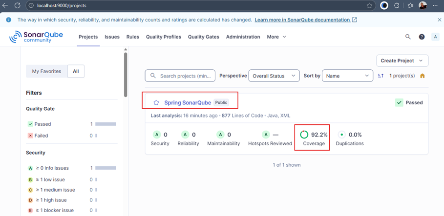

### 🧠 Nota estratégica

Separar la ejecución en dos fases (`verify` y `sonar:sonar`) permite validar localmente la cobertura con `JaCoCo` antes
de enviar el análisis. Si la cobertura no cumple el umbral mínimo, el análisis no se ejecuta, lo cual puede ser útil o
contraproducente según el contexto. Por eso, como vimos antes, se recomienda usar un umbral más flexible en `JaCoCo`
(ej. `80%`) y uno más estricto en `SonarQube` (ej. `90%`) para garantizar visibilidad sin bloquear el análisis.

## 🚀 2° Forma: Análisis de SonarQube mediante script de shell (`.sh`)

En proyectos reales, especialmente cuando trabajamos con múltiples entornos (desarrollo, QA, producción), es común
evitar hardcodear propiedades sensibles como la URL del servidor o el token de autenticación. Para ello, podemos usar
`scripts de shell (.sh)` que:

- Centralizan la lógica de ejecución del análisis.
- Cargan variables desde un archivo `.env` externo.
- Permiten ejecutar el análisis con un solo comando.
- Evitan exponer secretos en el código fuente.

### 📦 Paso 1: Crear archivo `.env` (no versionado)

Creamos un archivo `.env` en la raíz del proyecto con las variables necesarias para el entorno de desarrollo:

````properties
# ============================================================================
# Archivo: .env
# Descripción: Variables de entorno para análisis de SonarQube
# IMPORTANTE: Este archivo NO debe subirse a Git (agregar a .gitignore)
# ============================================================================
SONAR_HOST_URL_DEV=http://localhost:9000
SONAR_TOKEN_DEV=sqa_a0bc5503b5942ddf4739558c59bbb35b66869a66
````

### 📄 Paso 2: Crear plantilla `.env.example` (sí versionado)

Para documentar cómo debe estructurarse el archivo `.env`, creamos una plantilla de ejemplo que sí se sube al
repositorio:

````properties
# ============================================================================
# Plantilla de variables de entorno - Spring Boot + SonarQube
#
# Instrucciones:
#   1. Copia este archivo: cp .env.example .env
#   2. Reemplaza los valores xxx con tus valores reales
#   3. NUNCA subas .env a Git (ya está en .gitignore)
# ============================================================================
# =========================
# SONARQUBE - DESARROLLO
# =========================
# Obtén tu token en: http://localhost:9000 → My Account → Security → Generate Token
SONAR_HOST_URL_DEV=http://localhost:9000
SONAR_TOKEN_DEV=xxx
# =========================
# SONARQUBE - QA (Opcional)
# =========================
# SONAR_HOST_URL_QA=https://sonarqube-qa.miempresa.com
# SONAR_TOKEN_QA=xxx
# =========================
# SONARQUBE - PRODUCCIÓN (Opcional)
# =========================
# SONAR_HOST_URL_PROD=https://sonarqube.miempresa.com
# SONAR_TOKEN_PROD=xxx
````

### 🛡️ Paso 3: Ignorar `.env` en Git

Agregamos el archivo `.env` al `.gitignore` para evitar subir secretos al repositorio:

````bash
### Variables de entorno con secrets
.env
````

### ⚙️ Paso 4: Crear script `scripts/sonar-dev.sh`

Este script automatiza la ejecución del análisis en el entorno de desarrollo:

````bash
#!/bin/bash
# ============================================================================
# Script: sonar-dev.sh
# Descripción: Ejecuta análisis de SonarQube en entorno de DESARROLLO
# Uso: ./scripts/sonar-dev.sh
# Requisitos:
#   - Archivo .env en la raíz con SONAR_HOST_URL_DEV y SONAR_TOKEN_DEV
#   - Maven instalado
#   - Ejecutar desde la raíz del proyecto
# ============================================================================

set -e  # Detiene la ejecución si ocurre un error
set -u  # Trata las variables no definidas como error

# ============================================================================
# AUTO-CARGAR .env SI EXISTE (AUTOMÁTICO)
# ============================================================================
if [ -f ".env" ]; then
    echo "Cargando variables desde .env"

    # shellcheck disable=SC2046
    export $(grep -v '^#' .env | xargs)

    echo "SUCCESS: Variables cargadas"
else
    echo "ERROR: No se encontró .env en la raíz del proyecto"
    echo "Solución: Crea el archivo .env desde la plantilla .env.example"
    exit 1
fi

# ============================================================================
# VALIDAR VARIABLES REQUERIDAS
# ============================================================================
if [ -z "${SONAR_HOST_URL_DEV:-}" ]; then
    echo "ERROR: SONAR_HOST_URL_DEV no está definida en .env"
    exit 1
fi

if [ -z "${SONAR_TOKEN_DEV:-}" ]; then
    echo "ERROR: SONAR_TOKEN_DEV no está definida en .env"
    exit 1
fi

# ============================================================================
# CONFIGURACIÓN DEL ENTORNO
# ============================================================================
ENVIRONMENT="DEV"
PROJECT_KEY="spring-sonarqube"
SONAR_HOST_URL=${SONAR_HOST_URL_DEV}
SONAR_TOKEN=${SONAR_TOKEN_DEV}

# ============================================================================
# INFORMACIÓN DEL ANÁLISIS
# ============================================================================
echo ""
echo "============================================================"
echo "Ejecutando análisis SonarQube"
echo "============================================================"
echo "Entorno:          ${ENVIRONMENT}"
echo "Servidor:         ${SONAR_HOST_URL}"
echo "Proyecto:         ${PROJECT_KEY}"
echo "Token:            Configurado OK"
echo "============================================================"
echo ""

# ============================================================================
# EJECUCIÓN DEL ANÁLISIS
# ============================================================================
echo "Ejecutando tests y generando reporte de cobertura..."
echo ""

mvn clean verify sonar:sonar \
  -Dsonar.host.url="${SONAR_HOST_URL}" \
  -Dsonar.token="${SONAR_TOKEN}"

# ============================================================================
# FINALIZACIÓN
# ============================================================================
echo ""
echo "============================================================"
echo "¡Análisis completado con éxito!"
echo "============================================================"
echo "Ver resultados en:"
echo "${SONAR_HOST_URL}/dashboard?id=${PROJECT_KEY}"
echo "============================================================" 
````

✅ Beneficios de esta estrategia

| Ventaja               | Descripción                                                                    |
|-----------------------|--------------------------------------------------------------------------------|
| 🔐 Seguridad          | Evita hardcodear tokens o URLs en el código fuente                             |
| 🧩 Modularidad        | Permite definir múltiples entornos (`DEV`, `QA`, `PROD`)                       |
| 👥 Colaboración       | Facilita que otros desarrolladores ejecuten el análisis sin memorizar comandos |
| 📄 Documentación viva | `.env.example` actúa como guía clara y versionada                              |

### 🧪 Ejecutando el script de shell `sonar-dev.sh`

Para iniciar el análisis, basta con ejecutar el archivo `sonar-dev.sh`. Este script encapsula el comando completo de
análisis con `SonarQube` y muestra información enriquecida durante la ejecución: entorno actual, variables utilizadas,
mensajes de validación y confirmación de éxito.

📦 ¿Qué comando ejecuta internamente?

````bash
mvn clean verify sonar:sonar \
  -Dsonar.host.url="${SONAR_HOST_URL}" \
  -Dsonar.token="${SONAR_TOKEN}" 
````

Este comando:

- Ejecuta las pruebas y genera el reporte de cobertura con `JaCoCo`.
- Lanza el análisis estático con `SonarQube`.
- Envía los resultados al servidor configurado.
- Usa variables de entorno cargadas desde `.env`, evitando hardcodear secretos.

En este proyecto haremos uso de un archivo de script por entorno (`sonar-dev.sh`, `sonar-qa.sh`, etc.), ya que permite
mantener la configuración explícita, facilitar la ejecución por parte del equipo y documentar claramente las variables
utilizadas en cada contexto. Aunque esto implica cierta duplicación de lógica, priorizamos la claridad operativa
y la facilidad de uso para cada entorno.

🖥️ Ejemplo de ejecución

````bash
D:\programming\spring\01.udemy\02.andres_guzman\03.junit_y_mockito_2023\java-spring-test-suite\spring-sonarqube (feature/spring-sonarqube)
$ sh .\scripts\sonar-dev.sh
Cargando variables desde .env
SUCCESS: Variables cargadas

============================================================
Ejecutando análisis SonarQube
============================================================
Entorno:          DEV
Servidor:         http://localhost:9000
Proyecto:         spring-sonarqube
Token:            Configurado OK
============================================================

Ejecutando tests y generando reporte de cobertura...

[INFO] Scanning for projects...
[INFO]
[INFO] -------------------< dev.magadiflo:spring-sonarqube >-------------------
[INFO] Building spring-sonarqube 0.0.1-SNAPSHOT
[INFO]   from pom.xml
[INFO] --------------------------------[ jar ]---------------------------------
[INFO]
...
[INFO]
[INFO] Tests run: 35, Failures: 0, Errors: 0, Skipped: 0
[INFO]
[INFO]
[INFO] --- jacoco:0.8.12:report (report) @ spring-sonarqube ---
[INFO] Loading execution data file D:\programming\spring\01.udemy\02.andres_guzman\03.junit_y_mockito_2023\java-spring-test-suite\spring-sonarqube\target\jacoco.exec
[INFO] Analyzed bundle 'spring-sonarqube' with 4 classes
...
[INFO] Process project properties
[INFO] Process project properties (done) | time=21ms
[INFO] Project key: spring-sonarqube
...
[INFO] Analysis report compressed in 97ms, zip size=116.0 kB
[INFO] Analysis report uploaded in 245ms
[INFO] ANALYSIS SUCCESSFUL, you can find the results at: http://localhost:9000/dashboard?id=spring-sonarqube
[INFO] Note that you will be able to access the updated dashboard once the server has processed the submitted analysis report
[INFO] More about the report processing at http://localhost:9000/api/ce/task?id=57b563c9-a764-4032-9411-5b64155255f4
[INFO] Analysis total time: 8.298 s
[INFO] SonarScanner Engine completed successfully
[INFO] ------------------------------------------------------------------------
[INFO] BUILD SUCCESS
[INFO] ------------------------------------------------------------------------
[INFO] Total time:  34.648 s
[INFO] Finished at: 2025-11-03T13:04:40-05:00
[INFO] ------------------------------------------------------------------------

============================================================
¡Análisis completado con éxito!
============================================================
Ver resultados en:
http://localhost:9000/dashboard?id=spring-sonarqube
============================================================
````

Una vez finalizado el análisis, `SonarQube` nos redirige al dashboard del proyecto:

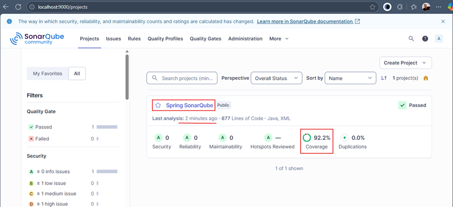

Desde allí podemos visualizar:

- Cobertura total y por archivo.
- Bugs, vulnerabilidades y code smells.
- Archivos duplicados.
- Cumplimiento del Quality Gate.
